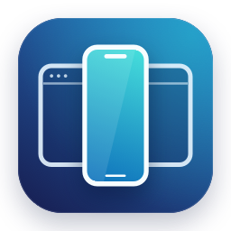

<p align="center">
  
</p>

# 手机视窗 · LikeWeiXin

一个轻量的原生 macOS 工具，通过 USB 实时展示 iPhone 当前屏幕。适合演示、教学，也可配合独立的“手机键盘”输入工具使用。

## 功能

- 默认只显示手机画面，工具区可展开、收起并自动隐藏。
- 双击画面撑满当前屏幕的可用高度，按手机比例计算宽度；再次双击恢复大小。
- 拖动画面移动窗口，从边缘按比例缩放；窗口默认置顶。
- 单台 iPhone 自动尝试连接，支持手动选择、刷新、暂停并清屏。
- 采用非激活展示窗口，保持展示与键盘输入工具各自独立。

Mac 无需登录微信；手机上的 App 继续在手机上运行。这是屏幕展示工具，当前不提供鼠标、触控板反向控制手机的功能。

## 运行与编译

需要 macOS 13 或更高版本、支持数据传输的 USB 数据线，以及能够向 Mac 提供屏幕来源的 iPhone。编译需要 Xcode 或 Command Line Tools，无第三方依赖。

```sh
git clone https://github.com/willrong1971/LikeWeiXin.git
cd LikeWeiXin
./scripts/check.sh
./build.sh
open "dist/手机视窗.app"
```

构建脚本生成当前 Mac 架构的 App。当前构建采用本地 ad-hoc 签名，尚未做 Developer ID 签名和 Apple 公证。

## 安装

先退出正在运行的“手机视窗”，然后运行：

```sh
./install.sh
```

默认安装到 `/Applications/手机视窗.app`。更新已有安装时，旧副本保存在本地 `.build/install-backups/` 中。也可指定其他应用目录：

```sh
./install.sh "$HOME/Applications"
```

安装后可从“应用程序”或聚焦搜索打开“手机视窗”。

## 使用

1. 用数据线连接 iPhone，解锁手机，并按手机提示信任这台 Mac。
2. 打开“手机视窗”，允许 macOS 的画面访问权限。系统把 USB 手机屏幕来源也归在“摄像头”权限中；程序只选择手机屏幕来源，不选择 Mac 摄像头或连续互通相机。
3. 在手机上打开要展示的 App。

鼠标移入或单击画面可唤出顶部工具栏。工具栏提供展开工具、撑满高度／恢复、退出；展开的工具卡提供设备、连接／暂停、刷新、置顶和打开“手机键盘”等操作。收起工具卡并移开鼠标后，只保留手机画面。

撑满高度使用屏幕的可用区域，保留菜单栏和 Dock 的空间。暂停、断开连接或退出会清空程序持有的画面。

与“手机键盘”配合时，让“手机键盘”保持前台输入状态，一边看置顶的展示窗口，一边输入。显式使用 Cmd-Tab 或 Dock 切换前台应用，仍可能触发输入工具自身的失焦停止逻辑。

## 隐私与资源

程序不提供录像、截图、聊天记录数据库、云端上传或消息日志功能。画面在内存中采集和显示，退出时结束采集并释放应用持有的画面。macOS 自身的权限记录、设备信任记录、系统日志和内存交换由系统管理，不能保证系统层面绝无残留。

实时画面会使用 CPU、内存、USB 带宽和手机电量。程序不设置后台常驻服务或开机自动启动。

## 图标与检查

图标为原创几何绘制，表达“桌面窗口中的手机画面”，没有使用第三方图像或微信标志。可重新生成所有尺寸：

```sh
xcrun swift scripts/generate-icon.swift
```

`./scripts/check.sh` 检查构建脚本、配置、图标资源，以及 13 个窗口几何场景。

当前已有本机验证：真实 USB 手机画面持续更新、暂停清屏、重新连接、工具区显隐、撑高与恢复、无边框边缘缩放、切换应用后继续显示。自动化或静态检查不代表所有设备、系统版本、横竖屏切换、长时间运行、拔插恢复及与输入工具的所有组合都已验证。

## 参考

- [Apple：连接设备的画面采集](https://support.apple.com/zh-cn/guide/quicktime-player/qtp356b55534/mac)
- [Apple：CoreMediaIO 屏幕采集设备](https://developer.apple.com/documentation/coremediaio/kcmiohardwarepropertyallowscreencapturedevices)
- [Apple：NSPanel 键盘焦点行为](https://developer.apple.com/documentation/appkit/nspanel/becomeskeyonlyifneeded)

© 2026 九福爸爸 9fbaba.
